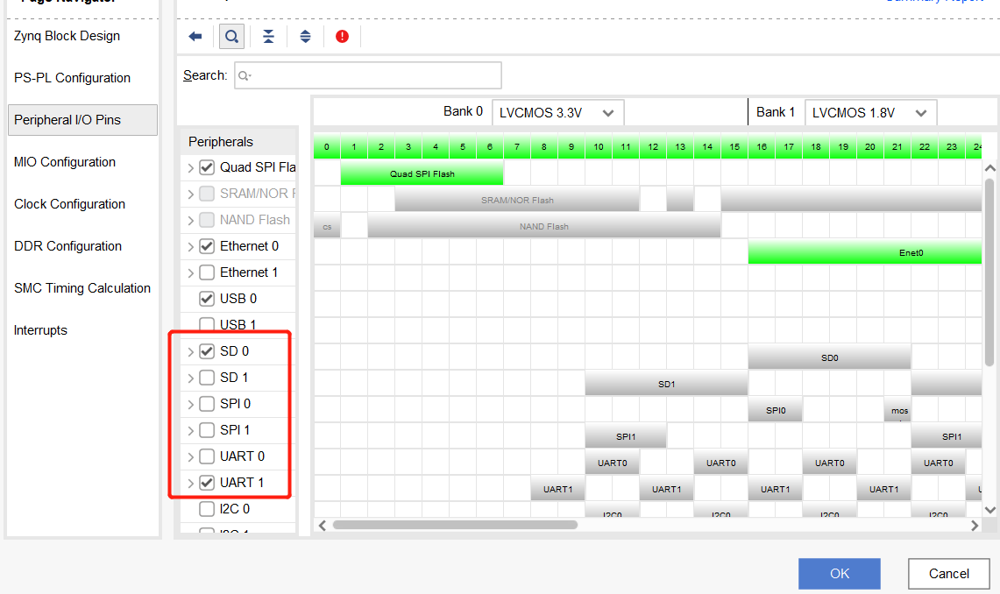

Notes inherited from the original upstream project. Directory names refer to that
project's layout; the equivalents in this repository are given in brackets.

**HLS folder** [`hls_prj/`]: the HLS-designed IP core for the PL side
**SDK folder** [`vitis_prj/`]: the bare-metal application code
**tools folder** [`tools/predictor/`]: image preprocessing (converting an image
into the `.bin` file the accelerator takes as input, and visualising the
detection result from the original image plus the accelerator's output)
**folded_weights**: YOLOv4-Tiny weights after BatchNorm folding

Things to watch out for:

- To use your own dataset, change the `OUT_CH` macro in `basic_op.h` to your own
  value (`= (number of classes + 5) x 3`), and point `classes_path` in `yolo.py`
  at your dataset's class file.
- When configuring the Zynq IP core in Vivado, DDR, UART and SD all have to match
  your own board. The configuration screens are shown below.

1. The DDR configuration screen, including **Memory Part** and **Effective DRAM
   Bus Width**.

2. The SD and UART configuration screen — that is, SD0 versus SD1, and UART0
   versus UART1.

