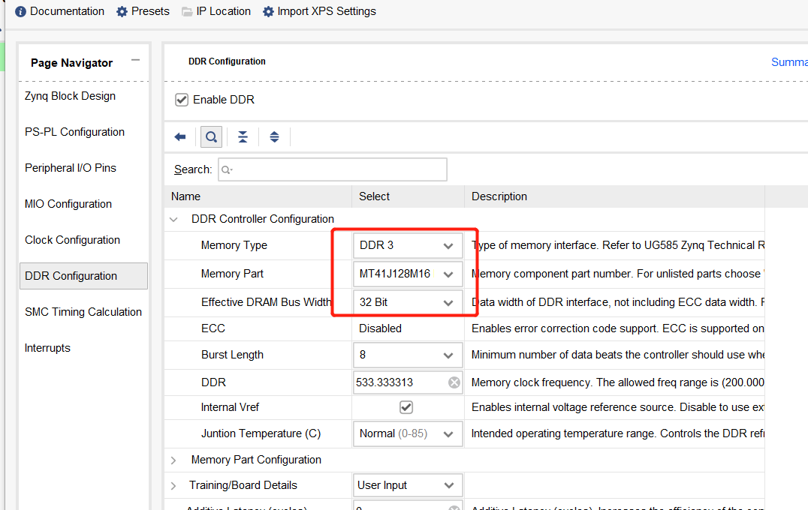

**HLS文件夹**:HLS设计的PL端的IP核  
**SDK文件夹**:裸机应用程序代码  
**tools文件夹**:负责图片预处理(即将图像转化为bin文件,作为加速器输入;根据原图以及加速器的输出，可视化目标检测的结果)  
**folded_weights**:BN融合后的yolo4 tiny权重  

需要注意的地方:
- 若要修改为自己的数据集,需将basic_op.h文件中的OUT_CH宏修改为自己的值(=(类别数+5)x3),同时将yolo.py文件中的classes_path修改为自己数据集的类别文件路径
- 在Vivado中配置Zynq IP核时，DDR、UART、SD需要根据自己的板子配置，其配置界面如下所示  
1. DDR配置界面,包括**Memory Part**和**Effective DRAM Bus Width**.

2. SD和UART配置界面,即SD0还是SD1,UART0还是UART1.

